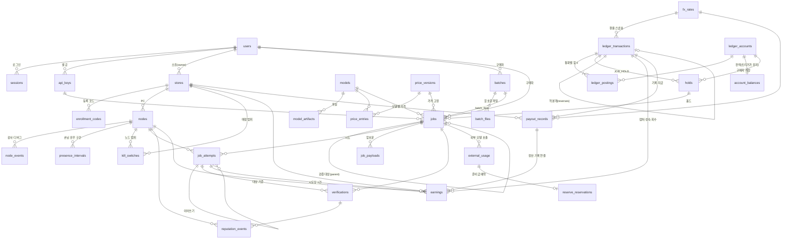

# DB 스키마와 불변식

> S03에서 만들었다. 원천은 `apps/server/src/db/schema/*.ts`(Drizzle)와 `apps/server/drizzle/*.sql`(검토한 마이그레이션)이다. 이 문서와 코드가 다르면 코드가 맞고 이 문서를 고친다. 설계 결정의 근거는 [ADR 0018](adr/0018-database-schema-invariants-and-migrations.md).

## 1. 원칙
| 규칙 | 내용 | 확인하는 테스트 |
|---|---|---|
| 시간 | 모든 시각 열은 `timestamptz`(UTC). DB 기본값 `now()`를 두지 않는다 — 서버가 주입된 `Clock`으로 값을 넣는다(가상 시계 테스트). 예외는 `spareon_meta.migrations.applied_at` | `test/db/schema.int.test.ts` |
| 돈 | 금액·가격·잔액은 모두 `bigint` 최소 단위(µCR, µTCR, 원, µUSD). `numeric`·`real`·`double precision`·`money` 열은 0개. 비율도 정수(`*_ppm`, `*_bps`, `rate_micros`) | `schema.int.test.ts` |
| ID | 앱이 만든 UUIDv7. 예외: `ledger_postings.id`, `outbox_events.id`는 `bigint identity`(순서가 의미 있고 밖으로 나가지 않음) | 팩토리 테스트 |
| 열거형 | Postgres enum 대신 `text + CHECK`(값 추가·down이 쉬움). 값 목록은 TS 상수 하나에서 나온다 | 드리프트 검사 |
| 구매자 콘텐츠 | 프롬프트·출력은 `job_payloads`·`batch_files`에 AES-256-GCM 암호문(`bytea`)으로만, 보존 기한 열(`expires_at`)과 함께. `jobs`에는 길이·토큰 수 같은 메타데이터만 | `schema.int.test.ts`(콘텐츠 열 목록 고정) |
| 해시·키 | 프로토콜과 같은 소문자 hex 문자열(CHECK). 비밀값(세션·API 키·등록 코드)은 해시만 | — |
| 크기 | `jsonb` 열마다 `pg_column_size` 상한 CHECK(설정·정책·메타데이터가 무한히 커지지 않게) | — |

## 2. ERD

모든 외래 키 관계다. 열 목록은 3절과 스키마 파일을 본다. 원장(`ledger_*`, `account_balances`, `holds`)은 다른 도메인 테이블을 외래 키로 참조하지 않는다(ARCHITECTURE 2.2) — 홀드는 `(purpose, reference_id)`로, 원장 계정은 `(owner_type, owner_id)`로 가리킨다.

그림에서 뺀 참조: `created_by`·`verified_by`·`recorded_by`·`settled_by`·`updated_by`·`actor_user_id` → `users`(누가 했는지).

## 3. 테이블

| 묶음 | 테이블 | 설명 | 보존·삭제 |
|---|---|---|---|
| 사람·인증 | `users` | 운영자·사장님·구매자. 이메일은 `lower(email)` 고유. 비밀번호는 argon2id 해시(S05) | 계정 수명 |
| | `sessions` | 웹 세션. 토큰은 SHA-256 해시만 | 만료 후 정리(S05) |
| | `api_keys` | 구매자 API 키. `prefix` 고유, 비밀은 HMAC만 | 폐기 전까지 |
| | `idempotency_keys` | HTTP 멱등(M7). `(scope, key)` 기본 키. 응답은 메타데이터만 | `expires_at` |
| 매장·노드 | `stores` | PC방. `verified_at`(D13), `accept_tcr_jobs`(D14), `store_salt`(ADR 0008) | — |
| | `enrollment_codes` | 등록 코드 해시. `single`은 `max_uses = 1` | — |
| | `nodes` | PC 1대. 상태(ARCHITECTURE 5.1) + 적격 여부 `eligible`. `UNIQUE(store_id, fp_store)`로 재부착 | — |
| | `node_events` | 노드 감사·디버그 기록(메타데이터만) | 정리 작업(S29) |
| | `presence_intervals` | 손님 유무 구간. 노드당 열린 구간 1개(부분 고유 인덱스) | 목표 90일 |
| | `kill_switches` | 킬스위치(노드·매장·전체). 활성 = `released_at IS NULL`, 범위당 활성 1개 | — |
| 모델·배포 | `models` | 노드 모델과 외부 모델. `params_millions`(정수) | — |
| | `model_artifacts` | GGUF·토크나이저·템플릿 파일(sha256, 서명) | — |
| | `runtime_releases`, `agent_releases` | 서명된 런타임·에이전트 빌드, 단계적 배포 상태(ADR 0015) | — |
| 가격·환율 | `price_versions`, `price_entries` | 가격표(추가 전용). 작업은 생성 때 버전을 고정 | 영구 |
| | `fx_rates` | 환율 스냅숏(추가 전용). `rate_micros` | 영구 |
| 원장 | `ledger_accounts` | 계정(추가 전용). 종류별 소유자 유형·허용 통화·음수 허용을 CHECK로 고정 | 영구 |
| | `ledger_transactions` | 거래(추가 전용). `idempotency_key` 고유, `created_xid`(트리거) | 영구 |
| | `ledger_postings` | 기입(추가 전용). 부호 있는 `amount`, 통화 = 계정 통화(복합 FK) | 영구 |
| | `account_balances` | 잔액 = 기입 합의 캐시. 기입 트리거만 쓴다 | 영구 |
| | `holds` | 크레딧 홀드. 끝난 홀드는 바뀌지 않는다 | 영구(삭제 금지) |
| 작업 | `jobs` | 작업이자 큐(ADR 0002). 메타데이터만 | 정책 S29 |
| | `job_attempts` | 시도. 작업당 활성 시도 1개 | 정책 S29 |
| | `job_payloads` | 프롬프트·출력·이어쓰기 접두사 암호문 | `expires_at`에 행 삭제(ADR 0010) |
| | `batches`, `batch_files` | 배치와 암호문 파일(인라인 또는 저장소 키) | 7일 |
| 검증 | `verifications` | 시도 단위 검증(점수는 `score_ppm`) | — |
| | `reputation_events` | 평판 입력(가중치는 천분율 정수) | — |
| 수익·정산 | `earnings` | 시도당 노드 몫 1건. 상태 ARCHITECTURE 5.5 | 영구(삭제 금지) |
| | `payout_records` | 수동 정산 **기록**(CR). 출금 코드는 없다(절대 규칙 2) | 영구(삭제 금지) |
| 외부 모델 | `external_usage` | 외부 호출 메타데이터(내용 없음) | — |
| | `reserve_reservations` | 외부 환전 준비금 예약(9.4) | — |
| 운영 | `settings` | 설정·기능 플래그(`ledger_frozen` 등), 개발 시드 표시 `dev.seed` | — |
| | `audit_log` | 민감 동작 감사 기록(추가 전용) | 영구 |
| | `outbox_events` | 트랜잭션 아웃박스(ID·상태만) | 발행 후 정리 |
| 메타 | `spareon_meta.migrations` | 적용한 마이그레이션 태그·체크섬 (`0000_schema` 표, `0001_invariants` 트리거, `0002_app_role` 역할, `0003_review_fixes` 검토 반영) | — |

## 4. 불변식과 강제 위치

'DB'는 앱이 실수하거나 버그가 있어도 DB가 거부한다는 뜻이다. 'DB 역할'은 서버 연결 역할(`spareon_app`)로는 우회할 수 없다는 뜻이다. 앱·대사 몫은 해당 차수가 테스트로 증명한다.

| ID | 불변식 | 강제 위치 | 구현 | 테스트 |
|---|---|---|---|---|
| M1 | 거래 하나의 통화별 기입 합 = 0, 기입 없는 거래 금지 | DB(커밋 시점) | 지연 제약 트리거 `ledger_tx_balanced`(거래마다)·`ledger_postings_balanced`(기입마다, 마지막 기입에서만 합 계산). `SET CONSTRAINTS ... IMMEDIATE` 뒤에 붙인 기입도 다시 검사. 기입은 그 거래 안에서 id가 커지는 순서로만 붙는다(작은 id를 골라 넣어 마지막 기입 검사를 피하는 우회 차단, 0003). 골라 넣은 id(`OVERRIDING SYSTEM VALUE`)도 이 검사를 통과해야 한다 | `invariants`·`roles.int.test.ts` |
| M1-b | 기입은 거래를 만든 DB 트랜잭션 안에서만 붙는다(커밋된 옛 거래나 아직 커밋 안 된 남의 거래에 합 0 쌍을 끼워 넣는 위조 차단) | DB | `created_xid = pg_current_xact_id()`를 트리거가 강제로 채우고 기입 때 비교. 거래 행이 보이지 않아도 거부(BJ004, 0003) | `invariants.int.test.ts` |
| M2 | 계정 잔액 = 그 계정 기입 합 | DB(트리거) + 대사(S06) | 기입 INSERT 트리거가 같은 트랜잭션에서 `balance += amount`, `version += 1`. 직접 쓰기는 트리거 밖에서 거부(BJ003) | 속성 테스트(`invariants.int.test.ts`) |
| M3 | 음수 불가 계정은 음수가 되지 않는다 | DB | `account_balances_non_negative_check`(`allow_negative`를 복합 FK로 복사). 음수 허용은 비용·출처·변환 계정 종류만(CHECK) | `invariants.int.test.ts` |
| M4 | 홀드 계정 잔액 = 활성 홀드 합, 미성숙 계정 = pending·held 수익 합 | 대사(S06) | — | S06 |
| M5 | 홀드는 `active`로 시작하고(INSERT 검사), 끝나면 `captured + released = amount`, 끝난 홀드는 다시 바뀌지 않는다 | DB | `holds_resolved_check`, 트리거 `holds_insert_guard`·`holds_guard`(BJ005) | `invariants.int.test.ts` |
| M6 | 캡처 ≤ 홀드, 금액은 줄지 않는다, 시도당 수익 1건 | DB + 앱(S06) | `holds_amounts_check`, `holds_guard`, `earnings_attempt_key` | `invariants`·`factories.int.test.ts` |
| M7 | 같은 멱등 키는 한 번만 | DB | `ledger_transactions_idempotency_key`, `idempotency_keys` 기본 키 | `invariants.int.test.ts` |
| M8 | TCR은 정산 처리 중·외부 환전 정산·준비금으로 가지 않는다 | DB | 계정 종류별 허용 통화 CHECK + 기입 통화 = 계정 통화(복합 FK). 정산 기록은 CR만(CHECK) | `invariants.int.test.ts` |
| M9 | 크레딧이 무에서 생기는 거래는 `TEST_TOPUP`·`SANDBOX_TOPUP`뿐 | 앱(S06) + 감사 | 거래 종류 CHECK 목록. 어떤 종류가 어떤 계정을 움직이는지는 S06 | S06 |
| M10 | 정산 기록에 연결된 수익은 `matured`에서 한 번만 연결, TCR 수익은 연결 불가, 같은 매장의 정산 기록에만 | DB | `earnings_payout_link_check`(CR만, 상태와 연결이 함께), 트리거 `earnings_insert_guard`(수익은 `pending`·`held`로, 정산 기록은 `recorded`로 시작)·`earnings_guard`(연결은 `matured`에서 한 번), 복합 FK `(payout_record_id, store_id)`·`(node_id, store_id)`·`(attempt_id, job_id, node_id)` | `factories.int.test.ts` |
| M11 | 준비금 = 테스트 충전 − 외부 지출 − 정산 지급 | 대사(S06) + 런북 | — | S06 |
| A1 | `ledger_accounts`·`ledger_transactions`·`ledger_postings`·`audit_log`·`price_versions`·`price_entries`·`fx_rates`는 추가만 | DB + DB 역할 | 행 트리거(UPDATE·DELETE)와 문장 트리거(TRUNCATE)로 거부(BJ002). `spareon_app`은 SELECT·INSERT 권한만 | `invariants`·`roles.int.test.ts` |
| A2 | `holds`·`earnings`·`payout_records`는 지우지 않고, 금액·주체는 바뀌지 않으며 끝난 상태는 최종 | DB + DB 역할 | 트리거(BJ005), 앱 역할에 DELETE 권한 없음 | `invariants`·`factories`·`roles` |
| A3 | 트리거를 끄는 경로가 없다 | DB 역할 | 모든 불변식 트리거 `ENABLE ALWAYS`(`session_replication_role = replica`에서도 동작). `spareon_app`은 테이블 소유자가 아니고 DDL·TRIGGER·TRUNCATE 권한이 없으며 슈퍼유저가 아니다 | `roles.int.test.ts` |
| A4 | 잔액 트리거를 임시 테이블로 속일 수 없다 | DB | `SECURITY DEFINER` 함수는 `search_path = pg_catalog, pg_temp` + 스키마를 붙인 이름 | `roles.int.test.ts` |
| Q1 | 큐·스윕·대사 조회가 인덱스를 탄다 | DB | `jobs_queue_model_idx`(`model_id, priority DESC, created_at, id`, `status = 'queued'` 부분), `jobs_queue_idx`(모델 무관), `job_attempts_offered_sweep_idx`·`job_attempts_lease_idx`(만료 스윕), `holds_active_account_idx`(M4 대사), `ledger_postings_account_idx`(M2 대사) | `factories.int.test.ts`(통계가 있는 2만 행에서 실제 claim 쿼리의 EXPLAIN) |
| C1 | 구매자 콘텐츠는 암호문으로만, 정해진 열에만 | DB 스키마 | `job_payloads.ciphertext`·`batch_files.ciphertext`(최소 28바이트), 콘텐츠 열 목록 고정 테스트 | `schema.int.test.ts` |

트리거가 쓰는 SQLSTATE: `BJ001` 합 불일치, `BJ002` 추가 전용 위반, `BJ003` 잔액 직접 쓰기, `BJ004` 다른 트랜잭션에서 기입, `BJ005` 돈 기록 금지 변경. 서버는 `src/db/errors.ts`의 `toDbError()`로 타입 있는 코드로 바꾼다(쿼리 내용·파라미터는 메시지에 넣지 않는다).

**DB가 막지 못하는 것(의도)**:
- 마이그레이션 소유자(DDL 권한) 연결은 트리거를 지우거나 끌 수 있다. 그래서 운영에서 서버는 소유자로 접속하지 않는다(5절).
- 거래가 '맞는 종류의 계정'을 움직이는지(예: `JOB_CAPTURE`가 홀드에서 나가는지)는 비즈니스 규칙이라 S06 원장 서비스와 대사가 맡는다.
- **앱 역할로도 크레딧을 만들 수 있다(M9는 DB가 막지 않는다).** `spareon_app`은 음수 허용 계정(예: `fx_conversion`)을 만들고, 그 계정에서 구매자 지갑으로 가는 합 0 거래를 쓸 수 있다. DB가 보장하는 것은 '합 0·음수 금지·기록 불변'까지이고, 누가 어떤 종류의 거래를 만들 수 있는지는 S06(거래 종류별 허용 계정)과 대사(M11: 준비금 대조, 발행 감사)가 막는다. 탈취된 앱 연결은 여전히 돈 사고다 — 다만 흔적(추가 전용 기록)은 지울 수 없다.

## 5. DB 역할
| 역할 | 누가 | 권한 |
|---|---|---|
| 마이그레이션 소유자 | `pnpm db:migrate`를 돌리는 연결(관리형 DB의 관리 계정) | 테이블·함수 소유, DDL |
| `spareon_app` (NOLOGIN 그룹) | 서버. 운영 로그인 역할을 이 역할의 멤버로 만든다(S30) | 추가 전용 표 7개: SELECT·INSERT / `account_balances`: SELECT / `holds`·`earnings`·`payout_records`: SELECT·INSERT·UPDATE / 나머지: SELECT·INSERT·UPDATE·DELETE / 시퀀스 USAGE·SELECT. TRUNCATE·TRIGGER·REFERENCES·DDL 없음 |

- 새 테이블은 그 테이블을 만드는 마이그레이션에서 권한을 정해야 한다. 정하지 않으면 `roles.int.test.ts`가 실패한다.
- 역할은 클러스터 전역이다. down 마이그레이션은 이 DB의 권한만 회수하고 역할은 지우지 않는다. 역할을 만들 권한(`CREATEROLE`)이 없는 DB에서는 마이그레이션이 실패한다(조용히 건너뛰면 서버가 소유자 권한으로 돌게 되므로). 그때는 관리자가 `CREATE ROLE spareon_app NOLOGIN`을 먼저 하면 된다.

## 6. 마이그레이션
| 명령 (`apps/server`) | 내용 |
|---|---|
| `pnpm db:generate` | 스키마(TS)에서 새 SQL 생성(drizzle-kit). 생성된 SQL은 사람이 읽고 다듬는다 |
| `pnpm db:migrate` | 대기 중인 마이그레이션 적용(`DATABASE_URL`) |
| `pnpm db:status` | 적용·대기 목록 |
| `pnpm db:rollback --yes [--steps N \| --all]` | down 파일로 되돌리기(데이터 손실, `--yes` 필수) |
| `pnpm db:seed` | 개발용 시드(로컬 DB만, 두 번 실행해도 변화 없음) |

- 실행기는 직접 만들었다(`src/db/migrate.ts`): 저널(`drizzle/meta/_journal.json`) 순서, 파일마다 한 트랜잭션, `spareon_meta.migrations`에 태그·SHA-256 체크섬 기록(줄 끝 CRLF·LF 무관), 적용 뒤 바뀐 파일·저널에 없는 적용 기록이 있으면 거부, advisory lock으로 동시 실행 직렬화, `lock_timeout` 10초.
- down은 `drizzle/down/<tag>.sql`. 되돌리기 전에 필요한 down 파일이 모두 있는지 먼저 확인한다.
- 트리거·함수·권한은 `drizzle-kit generate --custom`으로 만든 빈 마이그레이션에 손으로 쓴다(0001, 0002).
- 마이그레이션 파일 머리에 잠금 영향(`Locking:`)을 적는다. 실행기는 파일마다 트랜잭션으로 감싸므로 `CREATE INDEX CONCURRENTLY`는 마이그레이션 파일에 쓸 수 없다. 운영 중인 큰 테이블에 잠금이 긴 변경(열 타입 변경, 인덱스·제약 추가)이 필요해지면 ① 인덱스는 운영자가 `CONCURRENTLY`로 먼저 만들고 ② 마이그레이션은 `ADD CONSTRAINT ... USING INDEX` 또는 `NOT VALID` 뒤 `VALIDATE CONSTRAINT`로 짧게 잠그는 방식으로 나눈다(절차는 S30 런북). 파일럿 전에는 테이블이 비어 있어 해당 없음.
- 실행기 잠금은 `pg_try_advisory_lock`을 기다리되 상한(기본 120초)이 있다. 멈춘 실행기 하나가 배포를 무기한 막지 않는다. `db:status`는 읽기만 한다(DDL·잠금 없음).
- down 파일은 체크섬을 기록하지 않는다(개발·사고 대응용. 운영 되돌리기는 새 up 마이그레이션으로 한다).
- 검증(`test/db/migrate.int.test.ts`): up → 전체 down → up 뒤 카탈로그 덤프가 같다(수용 3), 단계별 down·up도 같다. 드리프트 검사 두 가지 — ① 마지막 drizzle-kit 스냅숏과 TS 스키마의 차이가 없다 ② drizzle-kit이 TS 스키마에서 만든 SQL을 빈 DB에 적용한 결과와 마이그레이션한 DB의 표·열·제약·인덱스가 같다(손으로 다듬은 SQL이 TS와 어긋나면 실패).

## 7. 테스트 키트
- `apps/server/vitest.config.ts` → `test/global-setup.ts`: 테스트 실행마다 템플릿 DB를 하나 만들어 마이그레이션을 적용한다. 테스트 파일은 `openTestDb()`(`test/support/db.ts`)로 `CREATE DATABASE ... TEMPLATE` 복제본을 받는다. `openTestDb({ empty: true })`는 빈 DB(마이그레이션 테스트용).
- DB는 `DATABASE_URL`·`TEST_DATABASE_URL`이 있으면 그 서버, 없으면 embedded-postgres(Docker 불필요). CI는 두 경로를 모두 돈다(`linux`: embedded, `postgres`: Postgres 16 서비스).
- 팩토리 `src/testing/factories.ts`: 사용자(역할별)·매장·노드·모델·가격표·작업·시도·원장 계정·원장 기입. `FakeClock`과 `createSeededRandom`(testkit)을 넣으면 ID까지 결정적이다.
