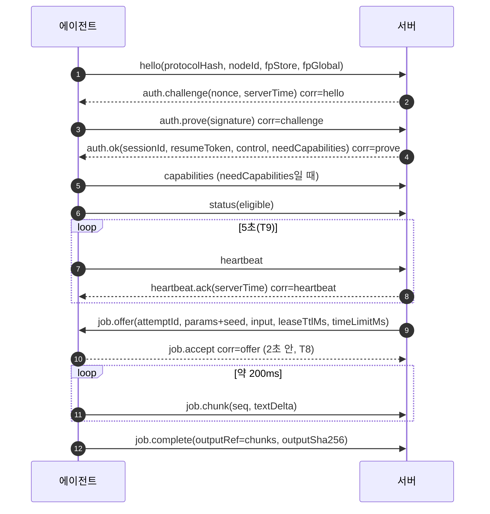
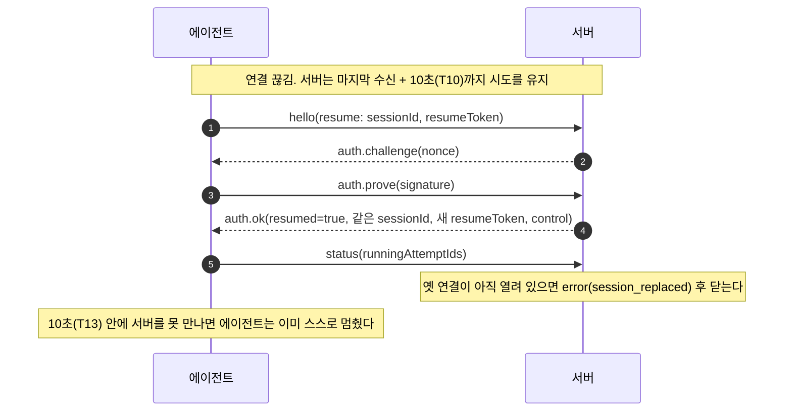
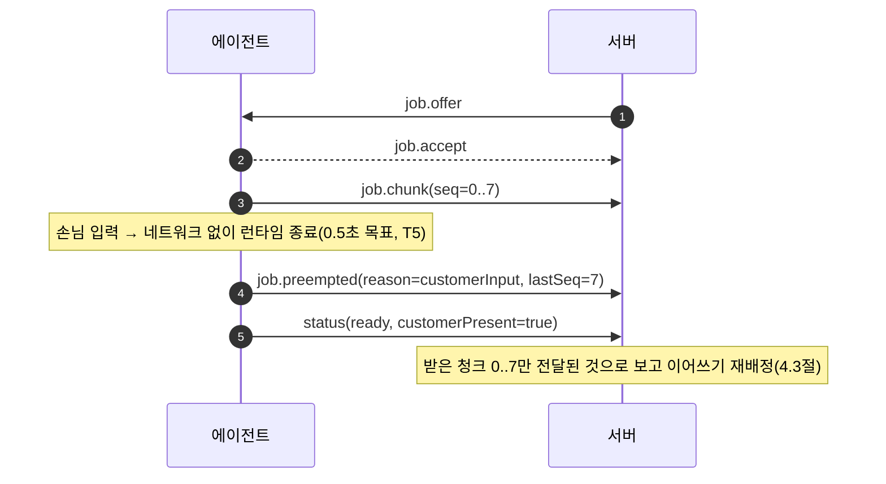
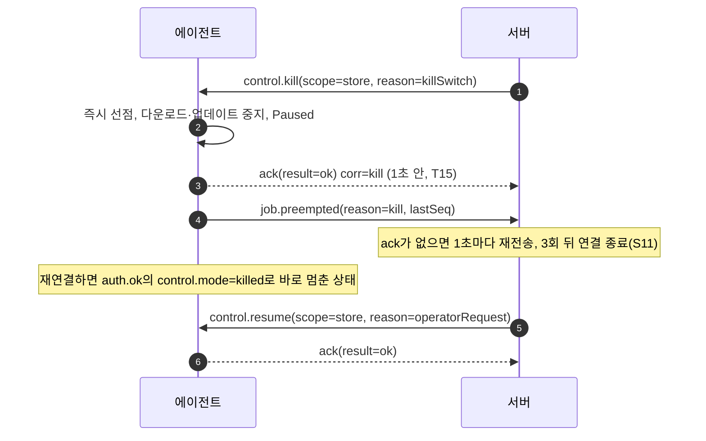

# 프로토콜 (에이전트 ⇄ 서버)

> S02 산출물. 원천은 `packages/protocol/schemas/`의 JSON Schema(2020-12)이고, 이 문서는 그 설명이다. 문서와 스키마가 다르면 스키마가 맞다 — 다만 메시지 표·오류 코드 표는 `packages/protocol/test/protocol-doc.test.ts`가 스키마와 대조하므로 어긋나면 테스트가 실패한다.
> 연결 처리(서버 S11, 에이전트 S17)는 아직 구현 전이다. 그 차수가 구현할 동작을 적은 문장에는 담당 차수를 괄호로 단다.
> 결정 근거: [ADR 0003](adr/0003-agent-protocol-websocket-json-schema.md)(WebSocket + JSON Schema), [ADR 0008](adr/0008-device-identity.md)(신원·서명), [ADR 0017](adr/0017-protocol-wire-rules-and-codegen.md)(엄격 JSON·정수만·정규화·생성기), [ARCHITECTURE](ARCHITECTURE.md) 7절(시간 예산)·12절(이견 D3·D4·D16·D24~D29).

## 1. 한눈에 보기
- 전송: TLS 위 WebSocket 하나(에이전트가 연다). 메시지 하나 = 텍스트 프레임 하나 = 봉투 하나. 등록(`enroll.*`)과 큰 입력(`inputRef`)은 HTTPS.
- 판정: TS(Ajv)와 Go(`santhosh-tekuri/jsonschema/v6`)가 같은 스키마 번들로 같은 순서의 검사를 하고, 같은 **판정 코드**를 낸다(4절). 290개 fixture로 매번 확인한다.
- 버전: `protocolHash` = 정규화한 스키마 번들의 SHA-256. 스키마가 한 글자라도 바뀌면 해시가 바뀐다(11절).

| 무엇 | 어디 |
|---|---|
| 스키마(원천) | `packages/protocol/schemas/` — `envelope.json`, `messages/<type>.json`, `http/<name>.json`, `manifests/{model,release}.json`, `defs/{common,policy,job-input}.json` |
| 데이터(해시에 포함) | `registry.json`(타입·방향·기대 응답·시간 제한·잘못됐을 때 에이전트 멈춤 여부 `onInvalid`), `limits.json`(한도), `defs/error-codes.json`(오류 코드 레지스트리) |
| 생성물 | `packages/protocol/src/generated/{protocol,bundle}.ts`, `apps/agent/internal/protocol/{zz_generated.go,bundle.json}` |
| 생성 명령 | `pnpm --filter @binjari/protocol gen` (낡으면 `test/generated.test.ts` 실패) |
| TS API | `@binjari/protocol`: `defaultCodec()`, `createCodec(bundle)`, `makeMessage`, `authSigningBytes`, `verifySignedManifest`, … |
| Go API | `binjari/agent/internal/protocol`: `NewCodec()`, `DecodeMessage`, `EncodeMessage`, `AuthSigningBytes`, `VerifySignedManifest`, … |
| fixture·벡터 | `packages/protocol/fixtures/{valid,invalid,vectors}/` — TS와 Go 테스트가 같은 파일을 읽는다 |

## 2. 봉투
```json
{ "v": 1, "type": "job.accept", "id": "01920000-0000-7000-8000-000000000101", "ts": "2026-10-09T04:36:00.000Z", "corr": "01920000-0000-7000-8000-000000000001", "payload": { "attemptId": "01920000-0000-7000-8000-000000000040" } }
```
| 필드 | 규칙 |
|---|---|
| `v` | 정수 `1` |
| `type` | 등록된 타입(5절). 형식 `^[a-z][a-z0-9]{0,15}(\.[a-z][a-z0-9]{0,15}){0,2}$` |
| `id` | 소문자 UUIDv7. 보내는 쪽이 만든다(서버는 주입된 Clock, 에이전트는 `NewUUIDv7(now, rand)`) |
| `ts` | RFC 3339 UTC 밀리초 정확히(`2026-10-09T04:36:00.000Z`). **정보용**이다. 판단에는 받는 쪽 시계를 쓴다(ARCHITECTURE 7절). 코덱은 모양(정규식)만 검사하므로 `2026-02-30T…`·`T24:00`처럼 형식은 맞고 달력에 없는 값도 통과한다 — 시각을 값으로 쓰는 쪽(`measuredAt`·`serverTime` 등)은 `parseTimestamp`/`ParseTimestamp`로 읽고, 이 함수는 달력 검사까지 해서 그런 값을 거부한다(양쪽 테스트) |
| `corr` | 응답 대상 메시지의 `id`. 타입마다 필수·선택·금지가 정해져 있다(5절 표) |
| `payload` | 객체. 타입별 스키마가 닫는다(추가 필드 금지) |

- 봉투에 추가 필드 금지. 메시지 최대 **1 MiB**(`limits.json` `maxMessageBytes`, 디코더 옵션으로 바꿀 수 있다).
- 인라인 구매자 텍스트(입력 `messages[].content` + `prompt` + `continuationPrefix`, 또는 출력 `outputText`)는 UTF-8 **256 KiB** 이하(`maxInlineTextBytes`). 넘으면 입력은 `inputRef`, 출력은 `job.chunk` 여러 개 + `outputRef`.
- 확장 지점은 없다(v1). 새 정보는 선택 필드 추가로만 늘린다(11절).

## 3. 엄격 JSON과 숫자
모든 메시지·HTTPS 본문·매니페스트·스키마 파일은 파싱 전에 다음을 통과해야 한다(TS `src/wire/strict-json.ts`, Go `strictjson.go`, 공유 벡터 `fixtures/vectors/json.json` 55개):
- 올바른 UTF-8, BOM 없음, 공백은 스페이스·`\t`·`\n`·`\r`만
- 숫자는 **정수만**: `-?(0|[1-9][0-9]*)`, 16자리 이하. 소수점·지수 금지(`1.0`도 금지)
- 문자열: 제어 문자 날것 금지, 표준 이스케이프만, `\u` 서로게이트는 짝이 맞아야 한다
- 한 객체 안 중복 키 금지(이스케이프를 푼 뒤 비교: `"a"`와 `"a"`는 같은 키)
- 중첩 깊이 32 이하, 최상위 값 뒤에 다른 것 없음

정수 범위: 스키마의 모든 정수에 `minimum`·`maximum`이 있고 |값| ≤ 2^53−1이다. 그래서 JS `number`와 Go `int64`가 같은 값을 갖는다. **64비트가 필요한 값은 프로토콜에 두지 않는다**: 해시·키·nonce·서명·토큰은 소문자 hex 문자열, 돈은 프로토콜에 없다(원장은 서버 안). 실수가 필요한 값은 단위를 바꾼다: `temperatureMilli`(0~2000 = 0.000~2.000), `topPMilli`(1~1000).

## 4. 판정 순서와 판정 코드
WS 메시지(받는 쪽 = `server` 또는 `agent`):
| 순서 | 검사 | 실패 코드 |
|---|---|---|
| 1 | 바이트 크기 > 한도 | `message_too_large` |
| 2 | 엄격 JSON(3절) | `malformed_json` |
| 3 | `envelope.json` | `invalid_envelope` |
| 4 | `type`이 레지스트리에 없음 | `unknown_type` |
| 5 | 받는 쪽이 그 타입을 보내는 쪽임 | `wrong_direction` |
| 6 | `messages/<type>.json` | `invalid_payload` |
| 7 | 인라인 텍스트 UTF-8 바이트 > 256 KiB | `invalid_payload` |

HTTPS 본문: 1(한도 64 KiB, `maxHttpBodyBytes`) → 2 → `http/<name>.json`·7 → `invalid_payload`.
`inputRef`로 받은 작업 입력 본문(`decodeJobInput`/`DecodeJobInput`): 1(한도 16 MiB `maxInputRefBytes`, 또는 더 작은 `inputRef.bytes`) → 2 → `defs/job-input.json` → `jobKind`에 맞는 모양(chat이면 `messages`, completion이면 `prompt`) → `invalid_payload`. 호출하는 쪽은 `bytes`·`sha256`도 확인하고, 실패는 모두 `job.fail(input_invalid)`.
- 처음 실패한 검사가 코드를 정한다. TS·Go 둘 다 이 순서를 지키고, `fixtures/invalid/**/<case>.<code>.json` 파일 이름의 코드와 정확히 같은 코드를 내야 테스트가 통과한다.
- 거부 사유 설명(`detail`)은 진단용이며 메시지 내용(프롬프트·출력)을 담지 않는다. 언어마다 문구가 달라도 된다.
- 봉투가 유효했으면 `id`와 `type`을 함께 돌려주므로 `error` 응답의 `corr`에 넣을 수 있다.
- 받는 쪽의 대응(구현 S11·S17): 서버는 `error`(code, fatal) 응답 후 기준(S11: 분당 5회)을 넘으면 연결을 닫는다. `message_too_large`는 곧바로 닫는다. 에이전트는 서버가 보낸 잘못된 메시지를 버리고 기록하며, **선점·멈춤 경로는 이 판정과 무관하게 동작한다**(ADR 0016).
- **에이전트 fail-safe(절대 규칙 1)**: 거부 결과의 `pause`(Go `Pause`)가 참이면 에이전트는 `control.pause`를 받은 것처럼 멈춘다(실행 중 시도 선점, GPU 메모리 해제, `Paused`). 참이 되는 경우는 받는 쪽이 에이전트이고 (a) 멈춤 명령(`registry.json`의 `onInvalid: "pause"` = `control.pause`·`control.kill`·`job.cancel`)이 `invalid_payload`로 거부됐거나 (b) 타입을 알 수 없는 거부(`message_too_large`·`malformed_json`·`invalid_envelope`)일 때다 — 그 메시지가 킬이었는지 모르므로 기본값은 멈춤이다. 풀림은 정상 `control.resume`으로만 한다. 에이전트는 다음 `status`에 `Paused`를 보고하므로, 서버(S11)는 자기가 보낸 적 없는 `Paused`를 보면 현재 제어 상태(정지 중이 아니면 `control.resume`)를 다시 보낸다. `control.resume`·`job.offer`·`config.update` 등이 잘못되면 버리기만 한다(멈춘 상태는 그대로, 정책은 이전 것 유지). 서버 쪽 거부에서는 언제나 거짓이다. 양쪽 계약 테스트가 모든 invalid fixture에 대해 이 규칙을 확인한다.
- `maxBytes`/`MaxBytes`를 0 이하로 주면 기본 한도를 쓴다(양쪽 같음).
- 보내는 쪽 보호: `encodeMessage`/`EncodeMessage`는 직렬화한 결과를 받는 쪽 파이프라인으로 다시 검사하고, 통과하지 못하면 보내지 않는다.

## 5. 메시지
방향: A = 에이전트, S = 서버. 시간 제한은 '기대 응답'이 와야 하는 시간이다(ARCHITECTURE 7절의 T값).

| 타입 | 방향 | 필수 필드 | 의미 | 기대 응답 | 시간 제한 |
|---|---|---|---|---|---|
| `hello` | A→S | `protocolHash`, `agentVersion`, `nodeId`, `capabilitiesDigest`, `fpStore`, `fpGlobal` · `corr` 금지 | 연결 직후 첫 메시지. 프로토콜 해시·버전·노드·지문 두 개(D3), 재개 시 `resume` | `auth.challenge`, `auth.fail` | 5초 |
| `auth.challenge` | S→A | `nonce`, `serverTime`, `expiresInMs` · 봉투 `corr` 필수 | 일회용 nonce(5초 만료, T14)와 서버 시각 | `auth.prove` | 5초 |
| `auth.prove` | A→S | `signature` · 봉투 `corr` 필수 | 서명 대상 바이트(9절)에 대한 ed25519 서명 | `auth.ok`, `auth.fail` | 5초 |
| `auth.ok` | S→A | `sessionId`, `resumeToken`, `resumed`, `configVersion`, `serverTime`, `heartbeatIntervalMs`, `control`, `needCapabilities` · 봉투 `corr` 필수 | 세션·재개 토큰·정책 버전·서버 시각·현재 제어 상태(재연결 시 바로 Paused, 4.9)·capabilities 재전송 요청 | — | — |
| `auth.fail` | S→A | `code` | 인증 거부. 보낸 뒤 서버가 연결을 닫는다 | — | — |
| `capabilities` | A→S | `gpus`, `cpu`, `ramMb`, `cacheDiskFreeMb`, `runtime`, `cachedModels`, `osBuild` | 하드웨어·런타임·캐시 모델 보고(auth.ok의 needCapabilities가 참이거나 바뀌었을 때) | — | — |
| `status` | A→S | `state`, `eligible`, `presence`, `gpus`, `runningAttemptIds`, `measuredAt` | 에이전트 상태·적격 여부·손님 신호 요약·GPU 지표·실행 중 시도(변할 때 즉시 + 주기) | — | — |
| `heartbeat` | A→S | (없음) · `corr` 금지 | 살아 있음. 서버가 마지막 수신 시각을 갱신(재개 창·리스, T10·T11) | `heartbeat.ack` | 10초 |
| `heartbeat.ack` | S→A | `serverTime` · 봉투 `corr` 필수 | 서버 시각(시계 차이 측정, 하루 중 시각 계산) | — | — |
| `job.offer` | S→A | `attemptId`, `jobKind`, `model`, `params`, `stream`, `timeLimitMs`, `leaseTtlMs` · `corr` 금지 | 시도 제안. 검증 표시 없음(D4), 시드 항상 포함, 마감은 상대 시간 | `job.accept`, `job.reject` | 2초 |
| `job.accept` | A→S | `attemptId` · 봉투 `corr` 필수 | 수락. 이때부터 리스 시작 | — | — |
| `job.reject` | A→S | `attemptId`, `reason` · 봉투 `corr` 필수 | 거절(사유 기록, 매칭 점수 반영) | — | — |
| `job.chunk` | A→S | `attemptId`, `seq`, `textDelta`, `tokensSoFar` · `corr` 금지 | 출력 조각(약 200ms 묶음). 리스 갱신·진행 보고 겸함 | — | — |
| `job.progress` | A→S | `attemptId`, `tokensSoFar` · `corr` 금지 | 청크 없이 생성 중일 때의 진행 보고(T35, 비스트리밍) | — | — |
| `job.complete` | A→S | `attemptId`, `finishReason`, `reportedTokensIn`, `reportedTokensOut`, `timings`, `outputSha256`, `runtime` · `corr` 금지 | 완료. 출력은 인라인 `outputText` 또는 `outputRef`(=청크 0..N−1 이어붙임) | — | — |
| `job.fail` | A→S | `attemptId`, `code`, `retryable` · `corr` 금지 | 실패(오류 코드, 재시도 가능 여부) | — | — |
| `job.preempted` | A→S | `attemptId`, `reason`, `lastSeq` · `corr` 금지 | 선점됨. `lastSeq`까지 보냈다(−1 = 보낸 청크 없음) | — | — |
| `job.cancel` | S→A | `attemptId`, `reason` · `corr` 금지 | 서버가 시도를 취소(구매자 취소·마감 등) | `ack` | 1초 |
| `control.pause` | S→A | `scope`, `reason` · `corr` 금지 | 일시정지(진행 중 시도는 선점 `pause`) | `ack` | 1초 |
| `control.resume` | S→A | `scope`, `reason` · `corr` 금지 | 일시정지 해제 | `ack` | 1초 |
| `control.kill` | S→A | `scope`, `reason` · `corr` 금지 | 킬스위치(즉시 선점 `kill` + 다운로드·업데이트 중지) | `ack` | 1초 |
| `config.update` | S→A | `version`, `policy` · `corr` 금지 | 매장 정책 교체(검증 후 원자 교체, 실패 시 이전 정책 유지 + `ack` rejected) | `ack` | 1초 |
| `model.ensure` | S→A | `manifest` · `corr` 금지 | 서명된 모델 매니페스트 — 내려받아 캐시하라 | `ack` | 1초 |
| `model.status` | A→S | `modelId`, `sha256`, `state`, `bytesDone`, `bytesTotal` | 모델 내려받기 진행·결과 | — | — |
| `update.available` | S→A | `manifest` · `corr` 금지 | 서명된 릴리스 매니페스트 — 업데이트 대상(ADR 0015) | `ack` | 1초 |
| `ack` | A→S | `result` · 봉투 `corr` 필수 | 명령 확인(`corr` = 명령 id). 거부면 오류 코드 | — | — |
| `error` | 양방향 | `code`, `message`, `fatal` | 메시지 거부·프로토콜 오류 통보(`corr` = 문제 메시지 id, 알 수 있을 때) | — | — |

### 5.1 메시지별 메모
- `hello.resume`: 재개 창(T10) 안에 다시 붙을 때 `sessionId`·`resumeToken`. 재개 토큰만으로는 인증되지 않는다 — 언제나 `auth.challenge`/`auth.prove`를 거친다(ADR 0008).
- `hello.fpStore`·`fpGlobal`: `HMAC-SHA256(storeSalt, 원본)`·`HMAC-SHA256(globalSalt, 원본)` 소문자 hex(D3). 원본(GPU UUID 등)은 보내지 않는다.
- `capabilitiesDigest`: 에이전트가 보낼 `capabilities` payload의 정규화 JSON(10절)의 SHA-256. 서버에 저장된 값과 다르면 `auth.ok.needCapabilities = true`.
- `capabilities.gpus[].uuidHash`: GPU마다 `HMAC-SHA256(storeSalt, GPU UUID)`.
- `status.presence.reasonCodes`: 작업 불가 사유 코드(snake_case, 중복 금지). 예: `customer_input`, `fullscreen_app`, `gpu_3d_busy`, `audio_playing`, `video_decode`, `helper_missing`, `min_idle_not_met`, `outside_schedule`, `server_time_unknown`, `gpu_too_hot`, `runtime_fault`(Faulted). 전체 목록은 `messages/status.json`.
- `job.offer`
  - **검증 표시 없음**(D4, ADR 0007): 검증·카나리아 작업과 일반 작업은 메시지 형태로 구별할 수 없다. `verification` 같은 필드는 스키마가 거부한다(fixture `job.offer/verification-flag`).
  - `params.seed`는 **항상 있다**(0~2^32−1). 서버가 정한다. 나머지 파라미터도 모두 필수(기본값을 서버가 채운다).
  - 입력은 `input`(인라인) 또는 `inputRef`(HTTPS, 둘 중 정확히 하나). `jobKind = chat`이면 `input.messages`, `completion`이면 `input.prompt`. `continuationPrefix`는 이어쓰기 접두사(4.3절).
  - `inputRef`: `url`(https만, 사용자 정보·`.`/`..` 경로 조각 금지), `token`(단기 서명 토큰, `Authorization`으로 보냄, 로그 금지), `sha256`(받은 본문의 해시), `bytes`. 받은 본문은 `decodeJobInput`/`DecodeJobInput`(4절)으로 검증하고 해시가 다르면 `job.fail(input_invalid)`. `defs/job-input.json`의 문자열 상한은 16 MiB(코드 포인트)라 큰 입력도 표현할 수 있고, 인라인일 때의 256 KiB는 판정 7단계(UTF-8 바이트)와 메시지 1 MiB 한도가 막는다. 그래서 256 KiB를 넘는 프롬프트와 선점 뒤 긴 `continuationPrefix`는 `inputRef`로 보낸다. 에이전트는 서버 호스트 외의 URL을 따르지 않아야 한다(구현 S17·S22).
  - 마감은 절대 시각이 아니라 `timeLimitMs`(받은 순간부터의 상대 시간, 에이전트 단조 시계). 리스는 `leaseTtlMs`.
- `job.chunk.seq`는 시도마다 0부터 1씩 증가한다. 서버는 받은 청크만 구매자에게 전달·과금 근거로 쓴다(ADR 0009). `tokensSoFar`·`reportedTokens*`는 교차 검증용이다.
- `job.progress`: 청크를 보내지 않는 동안(비스트리밍) 생성 중이면 `limits.json` `progressIntervalMs`(10초)마다 보낸다. T35(첫 진행 60초, 진행 사이 30초)를 넘으면 서버가 시도를 실패시킨다(D16).
- `job.complete.outputSha256`: 전체 출력 텍스트(UTF-8)의 SHA-256. 스트리밍이면 `outputRef = {kind: "chunks", chunkCount}`로 "청크 0..N−1을 이어붙인 것이 출력"임을 알린다.
- `job.preempted.reason`: `customerInput`(입력), `customerSignal`(입력 아닌 손님 신호, T36), `gpuBusy`, `thermal`, `schedule`, `pause`, `kill`, `deadman`(적격 임대 만료, T4), `shutdown`.
- 명령(`job.cancel`, `control.*`, `config.update`, `model.ensure`, `update.available`)은 1초(T15) 안에 `ack`가 와야 한다. 서버는 재전송 3회 뒤 연결을 닫는다. 같은 명령을 두 번 받아도 결과가 같게(멱등) 처리한다(구현 S11·S17).
- `error.message`는 짧은 영문 진단만(`diagnosticText`: 영숫자와 `()._,:/+#@=[]-`·공백, 256자). 사람에게 보이는 문구는 웹이 오류 코드로 만든다.

### 5.2 HTTPS 등록 본문 (WS 아님, 봉투 없음)
| 이름 | 방향 | 경로 | 필수 필드 | 응답 |
|---|---|---|---|---|
| `enroll.start.request` | A→S | `POST /api/agent/enroll/start` | `code`(8자, 0-9·A-Z에서 I·L·O·U 제외), `agentVersion`, `protocolHash` | `enroll.start.response`, `enroll.error` |
| `enroll.start.response` | S→A | 〃 | `enrollId`, `nonce`, `storeSalt`, `globalSalt`, `expiresInMs` | — |
| `enroll.complete.request` | A→S | `POST /api/agent/enroll/complete` | `enrollId`, `publicKey`, `fpStore`, `fpGlobal`, `signature`(9.2절) | `enroll.complete.response`, `enroll.error` |
| `enroll.complete.response` | S→A | 〃 | `nodeId`, `state`(offline 또는 pending), `reattached` | — |
| `enroll.error` | S→A | 〃 | `code`(남은 시도 수는 알리지 않는다) | — |

### 5.3 공용 정의 (`defs/`)
- **정책** `defs/policy.json`(`config.update.policy`):
  - `weeklySchedule`: 7개 문자열(0 = 월요일 … 6 = 일요일), 각 12자리 소문자 hex = 48비트. 비트 i(왼쪽 첫 비트가 i = 0)가 1이면 그 요일 `i × 30분`부터 30분 동안 작업 허용. `ffffffffffff` = 하루 종일.
  - `utcOffsetMinutes`: 매장 시간대(한국 540). 하루 중 시각은 PC 시계가 아니라 서버 시각(`auth.ok`·`heartbeat.ack`의 `serverTime`) + 에이전트 단조 경과 + 이 값으로 계산한다. 서버 시각을 모르면 '일정 밖'과 같다(ARCHITECTURE 7절).
  - `minIdleMinutes`(기본 10), `maxGpuTempC`(기본 80), `downloadWindow`(`startMinute` 이상 `endMinute` 미만, 지역 시각 분. start > end면 자정을 넘는다. start = end는 하루 전체(빈 창은 모델을 영영 못 받으므로 뜻을 두지 않는다), `endMinute` 1440 = 자정. 기본 120~600 = 02:00~10:00), `modelAllowlist`(빈 배열 = 서버 레지스트리 전체), `transparencyMode`(`off`·`notice`), `maxConcurrentJobs`(기본 1, 최대 4).
- **표시용 문자열** `displayText`(GPU·CPU 이름): 영숫자, 공백, `()._,:/+#@[]-`만, 1~128자. 따옴표·`<`·`>`·`&` 없음(THREAT_MODEL WEB-03). 에이전트는 `SanitizeDisplayText`로 맞춰 보낸다. 버전류는 `token`(`[A-Za-z0-9._+-]`, 64자).
- **서명된 매니페스트** `signedManifest`: `{manifest: <정규화 JSON 문자열>, signature: <hex 128>, keyId}` (9.3절).

## 6. 시퀀스

### 6.1 정상: 인증 → 오퍼 → 완료


### 6.2 재연결(재개 창 안)


### 6.3 선점(손님 착석)


### 6.4 킬스위치


## 7. 시간 제한
| 항목 | 값 | 근거 |
|---|---|---|
| `hello` → `auth.challenge`, 인증 전체, nonce 유효 | 5초 | T14 |
| `job.offer` → `job.accept`/`job.reject` | 2초 | T8 |
| 명령 → `ack` | 1초, 재전송 3회 | T15 |
| `heartbeat` 간격 / 서버 응답 기대 | 5초 / 10초 | T9, T13 |
| 재개 창 / 리스 | 마지막 수신 + 10초 / + 15초 | T10, T11 |
| 진행 없음 제한(수락→첫 진행 / 진행 사이) | 60초 / 30초, `job.progress`는 10초마다 | T35 |
| `inputRef` 토큰 수명 | 목표 5분 | AGT-13 |

## 8. 오류 코드
`schemas/defs/error-codes.json`이 원천이다. `from`은 그 코드를 보내는 쪽(`any` = 양쪽). '에이전트 동작'은 에이전트가 그 코드를 받았을 때 할 일이다(에이전트가 보내는 코드는 `—`).

| 코드 | 보내는 쪽 | 재시도 | fatal | 에이전트 동작(받았을 때) | 의미 |
|---|---|---|---|---|---|
| `message_too_large` | any | 아니오 | 예 | `closeConnection` 연결을 닫는다 | 메시지가 바이트 상한을 넘음 |
| `malformed_json` | any | 아니오 | 아니오 | `dropMessage` 버린다 | 엄격 JSON이 아님(3절) |
| `invalid_envelope` | any | 아니오 | 아니오 | `dropMessage` 버린다 | 봉투가 envelope.json에 맞지 않음 |
| `unknown_type` | any | 아니오 | 아니오 | `dropMessage` 버린다 | 등록되지 않은 메시지 타입 |
| `wrong_direction` | any | 아니오 | 아니오 | `dropMessage` 버린다 | 이 쪽이 보내는 타입이 아닌데 받음 |
| `invalid_payload` | any | 아니오 | 아니오 | `dropMessage` 버린다 | 타입별 스키마 또는 의미 검사(인라인 256 KiB) 위반 |
| `not_authenticated` | server | 예 | 예 | `reconnectBackoff` 백오프 재연결 | 인증 전에 hello·auth.prove 외 메시지 |
| `protocol_unsupported` | server | 아니오 | 예 | `waitForUpdate` `Updating` 대기 | 서버가 모르는 protocolHash |
| `agent_too_old` | server | 아니오 | 예 | `waitForUpdate` `Updating` 대기 | 에이전트 버전이 서버 최소 버전보다 낮음 |
| `auth_invalid_signature` | server | 예 | 예 | `reconnectBackoff` 백오프 재연결 | auth.prove 서명 검증 실패 |
| `auth_nonce_expired` | server | 예 | 예 | `reconnectBackoff` 백오프 재연결 | nonce 만료 또는 재사용 |
| `auth_timeout` | server | 예 | 예 | `reconnectBackoff` 백오프 재연결 | 인증 제한 시간(T14) 초과 |
| `node_unknown` | server | 아니오 | 예 | `reenroll` 재등록 | 등록되지 않은 nodeId |
| `node_pending` | server | 예 | 예 | `stopAndWait` 작업 없이 대기 | 사장님 승인 대기 노드 |
| `node_disabled` | server | 예 | 예 | `stopAndWait` 작업 없이 대기 | 사장님·운영자가 끈 노드 |
| `node_quarantined` | server | 아니오 | 예 | `stopAndWait` 작업 없이 대기 | 격리된 노드 |
| `node_excluded` | server | 아니오 | 예 | `stopAndWait` 작업 없이 대기 | 운영자가 영구 제외한 노드(D20) |
| `clone_suspected` | server | 아니오 | 예 | `stopAndWait` 작업 없이 대기 | 같은 신원이 다른 지문·동시 연결로 보임(복제 의심) |
| `session_replaced` | server | 예 | 예 | `reconnectBackoff` 백오프 재연결 | 재개 토큰을 가진 새 연결이 이 세션을 가져감 |
| `rate_limited` | server | 예 | 아니오 | `reconnectBackoff` 백오프 재연결 | 메시지·연결 속도 제한 |
| `server_draining` | server | 예 | 예 | `reconnectBackoff` 백오프 재연결 | 서버 인스턴스 종료 중(T32) |
| `internal_error` | any | 예 | 아니오 | `reconnectBackoff` 백오프 재연결 | 보낸 쪽 내부 오류 |
| `enroll_code_invalid` | server | 아니오 | 아니오 | `stopAndWait` 작업 없이 대기 | 등록 코드가 없음·만료·폐기·잠김(남은 시도 수는 알리지 않음) |
| `enroll_expired` | server | 예 | 아니오 | `retryLater` 나중에 재시도 | 등록 세션 만료, 처음부터 다시 |
| `attempt_unknown` | agent | 아니오 | 아니오 | `none` — | 이 노드에서 실행 중이 아닌 attemptId |
| `runtime_start_failed` | agent | 예 | 아니오 | `none` — | 추론 런타임 시작 실패 |
| `runtime_crash` | agent | 예 | 아니오 | `none` — | 시도 중 런타임 비정상 종료 |
| `model_load_failed` | agent | 예 | 아니오 | `none` — | 모델 적재 실패 |
| `out_of_vram` | agent | 예 | 아니오 | `none` — | GPU 메모리 부족 |
| `input_fetch_failed` | agent | 예 | 아니오 | `none` — | inputRef 내려받기 실패 |
| `input_invalid` | agent | 아니오 | 아니오 | `none` — | 내려받은 입력의 해시·스키마 불일치 |
| `output_too_large` | agent | 아니오 | 아니오 | `none` — | 출력이 프로토콜 한도를 넘음 |
| `manifest_signature_invalid` | agent | 아니오 | 아니오 | `none` — | 매니페스트 서명·키 ID 거부 |
| `manifest_invalid` | agent | 아니오 | 아니오 | `none` — | 매니페스트가 정규형이 아니거나 스키마 위반 |
| `manifest_downgrade` | agent | 아니오 | 아니오 | `none` — | 더 새 버전이 아니고 서명된 롤백도 아님 |
| `policy_invalid` | agent | 아니오 | 아니오 | `none` — | config.update 정책 거부(이전 정책 유지) |
| `download_failed` | agent | 예 | 아니오 | `none` — | 아티팩트 내려받기 실패 |
| `hash_mismatch` | agent | 예 | 아니오 | `none` — | 내려받은 아티팩트 해시가 매니페스트와 다름 |
| `disk_full` | agent | 예 | 아니오 | `none` — | 캐시 디스크 공간 부족 |

## 9. 서명 대상 바이트
모든 서명은 ed25519이고, 키·서명은 소문자 hex(공개키 64자, 서명 128자)다. 검증은 형식이 정확하지 않은 hex, 비정규 스칼라(S ≥ L), **받아들일 수 없는 공개키**를 **언어와 무관하게 거부**한다. 받아들일 수 있는 공개키(`isAcceptablePublicKey`/`IsAcceptablePublicKey`)는 정규 인코딩(y < p)이고 작은 차수 점 8개가 아니어야 한다. 일반 RFC 8032 검증(OpenSSL, Go `crypto/ed25519`)은 작은 차수 공개키를 받아들이는데, 그런 키로는 개인키 없이 서명을 위조할 수 있고(벡터에 위조 사례 7건), 비정규 인코딩은 한 키에 여러 표기를 만들어 복제 탐지(ADR 0008)를 흐린다. 등록 서명 검증이 이 검사를 거치므로 그런 키는 등록되지 않는다. 주의: 섞인 차수(큰 차수 + 작은 차수 성분) 키까지 막는 부분군 검사는 하지 않는다 — 정직한 에이전트는 만들지 않고, 양쪽 검증기가 같은 cofactorless 식을 써서 판정 차이도 없다. 각 서명 대상은 용도별 **도메인 문자열 + 줄바꿈**으로 시작하므로 한 용도의 서명이 다른 용도에서 통과하지 않는다. 구성요소는 줄바꿈이 들어갈 수 없는 형식(소문자 hex, UUIDv7)으로 먼저 검사하고, 아니면 바이트를 만들지 않는다(필드 경계 모호성 없음). 고정 키(RFC 8032 테스트 키)·고정 nonce 벡터: `fixtures/vectors/signatures.json`.

### 9.1 `auth.prove`
```
"binjari-auth-v1\n" + nonce + "\n" + nodeId + "\n" + protocolHash        (UTF-8)
```
`nonce`는 `auth.challenge`의 64자 hex, `nodeId`는 `hello`의 UUIDv7, `protocolHash`는 `hello`의 64자 hex. 서버는 이 세션에서 실제로 보낸 nonce와 받은 hello 값으로 바이트를 만들어 검증한다. nonce는 한 번만 쓰고 5초 뒤 만료된다(S11).

### 9.2 `enroll.complete`
```
"binjari-enroll-v1\n" + nonce + "\n" + enrollId + "\n" + publicKey + "\n" + fpStore + "\n" + fpGlobal
```
`nonce`·`enrollId`는 `enroll.start.response`의 값. 서명 키는 등록하려는 새 공개키(키 소유 증명). 서버(S10)는 서명을 확인하기 전에 `isAcceptablePublicKey`로 키를 거부할 수 있고, 저장하는 공개키 문자열은 정규 인코딩 하나뿐이므로 문자열 비교로 같은 키를 찾는다.

### 9.3 매니페스트(모델·릴리스)
```
"binjari-model-manifest-v1\n" + manifest        또는        "binjari-release-manifest-v1\n" + manifest
```
`manifest`는 매니페스트 객체의 **정규화 JSON 문자열**이고 메시지에 그 문자열 그대로 실린다. 받는 쪽 순서(검증 후 파싱):
1. `keyId`가 신뢰 키 목록에 있다(에이전트 내장: 현재 키 + 다음 키, ADR 0015) → 아니면 `manifest_signature_invalid`
2. 받은 문자열 바이트 그대로 서명 확인 → 실패면 `manifest_signature_invalid`
3. 엄격 JSON 파싱 → 다시 정규화한 결과가 받은 문자열과 **바이트까지 같다** → 아니면 `manifest_invalid`(공백·키 순서·중복 키·실수 모두 여기서 걸린다)
4. `manifests/<kind>.json` 스키마 → 아니면 `manifest_invalid`(예: `../` 경로, http URL)
5. 그 다음에야 내용을 쓴다. 버전 단조성·롤백 규칙은 S21(`manifest_downgrade`).

## 10. 정규화 JSON (RFC 8785 부분집합)
- 객체 키는 **UTF-16 코드 단위 순**으로 정렬(JS 기본 정렬. UTF-8 바이트 순과 다르다: `"｡"`(U+FF61) > `"😀"`)
- 공백 없음. 문자열은 `"`·`\`·U+0020 미만 제어 문자만 이스케이프(`\b \t \n \f \r`, 나머지 `\u00xx` 소문자), 나머지(한글·이모지·`<`·`&`·U+2028)는 UTF-8 그대로
- 숫자는 안전 정수만(|n| ≤ 2^53−1), 십진 표기, `-0`은 `0`
- 쓰는 곳: `protocolHash`(스키마 번들), 매니페스트 서명, `capabilitiesDigest`

## 11. 버전 정책
- `protocolHash` = SHA-256(정규화 JSON(`{"format":"binjari-protocol-bundle/1","files":{<schemas/ 아래 상대 경로>: <파싱한 JSON>}}`)). 서식·키 순서·줄바꿈은 해시를 바꾸지 않고, 내용 변경은 무엇이든 바꾼다. TS와 Go가 같은 값을 각자 계산하는 테스트가 있다(Go는 원천 스키마 파일을 직접 읽어 계산).
- 서버는 지원 해시 집합(`SUPPORTED_PROTOCOL_HASHES`, 현재 해시가 맨 앞)을 갖고, 모르는 해시는 `auth.fail(protocol_unsupported)`. 에이전트는 이 코드를 받으면 `Updating`으로 가서 업데이트를 기다린다.
- **호환되는 변경**(필드 추가는 선택 필드로만, 열거값 추가, 한도 완화)도 해시를 바꾼다. 그래서:
  1. 바꾸기 전 번들(`src/generated/bundle.ts`의 내용)을 `packages/protocol/history/<옛 해시>.json`으로 보관하고 그 해시를 지원 집합에 남긴다.
  2. 서버는 세션마다 그 세션 해시의 코덱(`createCodec(bundle)`)으로 받고 **보낸다** — 옛 에이전트는 모르는 필드를 거부하므로(추가 필드 금지) 새 필드를 보내면 안 된다.
  3. 모든 노드가 새 버전이 되면(ADR 0015 단계적 배포) 옛 해시를 뺀다.
- **깨지는 변경**(필드 삭제·이름 변경, 선택 → 필수, 열거값 삭제, 한도 축소, 의미 변경): 새 해시 + 서버가 옛·새 코덱을 함께 지원하는 기간 + 단계적 업데이트. 봉투 형식 자체를 바꾸면 `v`를 올린다.
- 금지: 기존 필드의 의미만 바꾸기(해시는 바뀌어도 옛 코덱이 같은 바이트를 다르게 해석한다).

## 12. 보안 고려
- **재전송**: `auth.prove`는 일회용 nonce에 묶인다. 메시지 `id`는 중복 감지용이며, 돈·상태에 영향을 주는 처리(`job.complete` 첫 유효 완료, 캡처)는 서버 쪽 조건부 갱신·멱등 키로 막는다(AGT-08, S11·S12). 시도 메시지는 세션의 노드가 그 시도의 노드인지 서버가 확인한다(AGT-09).
- **크기**: 메시지 1 MiB, HTTPS 본문 64 KiB, 인라인 텍스트 256 KiB, `inputRef` 본문 16 MiB, 모든 문자열 `maxLength`, 모든 배열 `maxItems`, 모든 정수 범위, 중첩 32단계. 생성기가 규칙을 강제하므로 '제한 없는 필드'는 만들 수 없다(13절).
- **중계(가정)**: `auth.prove` 서명 대상에는 서버 식별자(audience)가 없다. 같은 `protocolHash`를 쓰는 다른 서버(스테이징·악성)가 운영 서버의 challenge를 노드에 중계하면 그 노드로 가장할 수 있으나, 노드는 TLS로 운영 서버 인증서를 확인하고 접속 주소는 설치 때 고정되므로 막힌다고 가정한다. 이 가정이 깨지면(예: 노드가 여러 서버에 접속) 도메인 문자열을 `binjari-auth-v2`로 올리고 서버 origin을 구성요소로 넣는다.
- **서명 대상**: 9절. 도메인 분리, 형식 검사로 경계 고정, 비정규 스칼라 거부, 매니페스트는 검증 후 파싱.
- **신뢰 경계**: 노드가 보낸 문자열(이름·버전·오류 메시지)은 좁은 문자 집합·길이 상한(WEB-03). 표시할 때도 웹은 이스케이프한다(S23).
- **구별 불가능성**: `job.offer`에는 검증 표시가 없고 시드는 항상 있다(D4). 검증 작업의 크기·지연 분포 비교는 S13.
- **내용 비노출**: 거부 사유(`detail`)·오류 메시지에 프롬프트·출력을 넣지 않는다(테스트로 확인).
- **원격 로딩 없음**: 스키마 `$id`는 `https://schemas.binjari.invalid/…`(절대 해석되지 않는 주소)이고, 두 검증기 모두 외부 로더를 쓰지 않는다.

## 13. 스키마 작성 규칙 (생성기가 강제)
1. 허용 키워드만. `format`, `title`·`description`·`examples`·`default`(사람이 읽는 문구) 금지
2. `type`은 object·array·string·integer·boolean. `number`·`null` 금지
3. 문자열은 `maxLength`(열거·상수 제외). `pattern`은 ASCII, `^…$`로 고정, 최상위 `|` 금지(`^a|b$`는 한쪽만 고정된다). `maxLength`·`maxItems`는 16 MiB(`maxInputRefBytes`) 이하. Go(RE2)는 반복 횟수 곱이 1000을 넘는 패턴을 거부하므로 중첩된 `{m,n}` 대신 `*` + `maxLength`를 쓴다
4. 배열은 `items`·`maxItems`. 선택 배열은 `minItems ≥ 1`(Go `omitempty`가 값을 잃지 않게). 필수 배열이 Go에서 nil이면 생성된 `MarshalJSON`이 `null` 대신 `[]`로 쓴다(빈 상태 보고와 `capabilitiesDigest`가 nil/빈 슬라이스에 따라 달라지지 않게)
5. 정수는 `minimum`·`maximum`, |값| ≤ 2^53−1
6. 객체는 `additionalProperties: false`(봉투의 `payload` 하나만 예외, 메시지 스키마가 닫는다), `required`는 선언된 속성만
7. `oneOf`·`anyOf`·`allOf`·`not`·`if/then/else`는 부모가 선언한 속성에 대한 제약(`required`·`const`·`enum`)만
8. 열거값 표기: 상태·사유(`reason`, `state`, `kind`)는 camelCase(명세 표기), 코드(`code`, `reasonCodes`)는 snake_case

## 14. 테스트
| 무엇 | TS (`packages/protocol/test/`) | Go (`apps/agent/internal/protocol/`) |
|---|---|---|
| 모든 fixture 판정 일치(수용 기준 2) | `contract.test.ts` | `contract_test.go` |
| 왕복(디코드 → 인코드 → 같은 의미) | `contract.test.ts` | `contract_test.go` |
| `protocolHash` 일치(수용 기준 3) | `generated.test.ts` | `hash_test.go`(원천 스키마에서 직접 계산) |
| 서명 벡터(수용 기준 4) | `signatures.test.ts` | `sign_test.go` |
| 엄격·정규화 JSON 벡터 | `json-vectors.test.ts` | `json_test.go` |
| 생성물 최신성 | `generated.test.ts` | `hash_test.go`(내장 번들) |
| 스키마 규칙 | `schemas.test.ts` | — |
| 이 문서의 표 = 스키마 | `protocol-doc.test.ts` | — |
